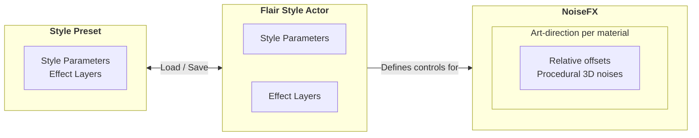

From an artist's perspective, Flair for Unreal Engine currently consists of only three elements.

- The **Style Presets** can **load/save** the details of a **Style Actor** including its style parameters and effect layers.
- The **Flair Style Actor** **containing the style parameters and effect layers** within the level that define the style.
- The **NoiseFX**, which are defined by the **Style Actor** and have the **controls to art-direct effects per material**.

The heart of Flair within Unreal Engine lies in the FlairStyle actor, so it's time to [create a Flair Style Actor](/unreal/artist-guide/create-style-actor/).
