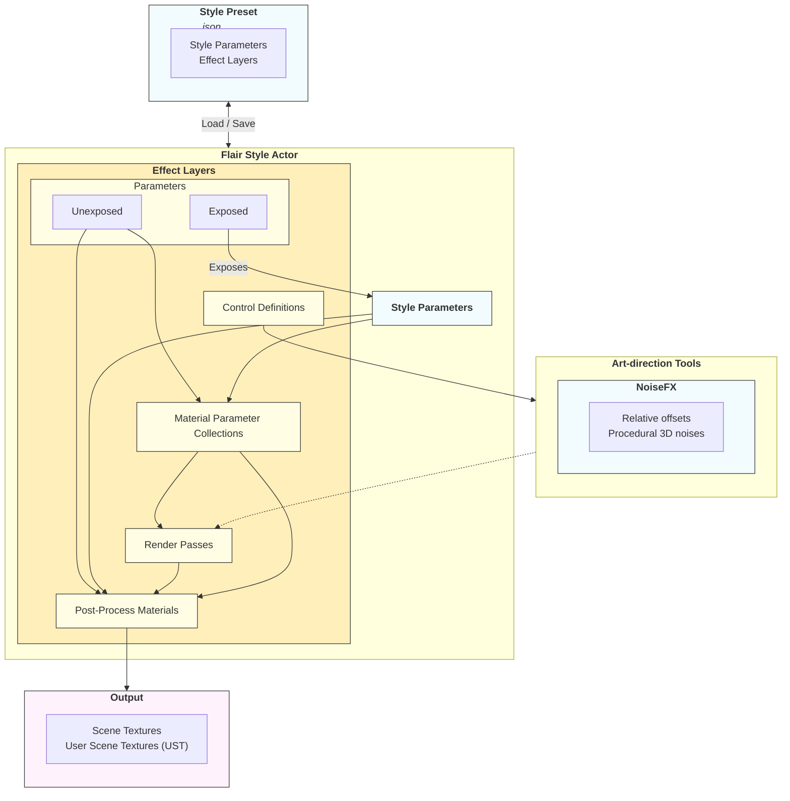

From a technical artist's perspective, Flair for Unreal Engine consists of four elements.

- The **Style Presets** containing **parameter values and effect layer references** of a Flair style. Presets are saved in plain-text _.json_ files, making them revision-friendly and platform agnostic.
- The **Flair Style Actor** containing **parameters and effect layers** defining the style within a level. Effect layers are the building blocks of a style and the most important concept within Flair.
- The **Art-direction Tools**, defined from each effect layer's control definitions, in charge of modifying the render passes controlling the style.
- The **Output**, which can be to custom User Scene Textures (UST) or overriding Scene Textures.

Hopefully by the end of this guide, you'll have a clear understanding on how everything works and can confidently expand upon and even create your own Flair styles.

The heart of Flair within Unreal Engine lies in the FlairStyle actor and how it's effect layers entirely define the style, so it's time to [Mix-and-Match Flair Effect Layers](/unreal/technical-artist-guide/mix-and-match/).
